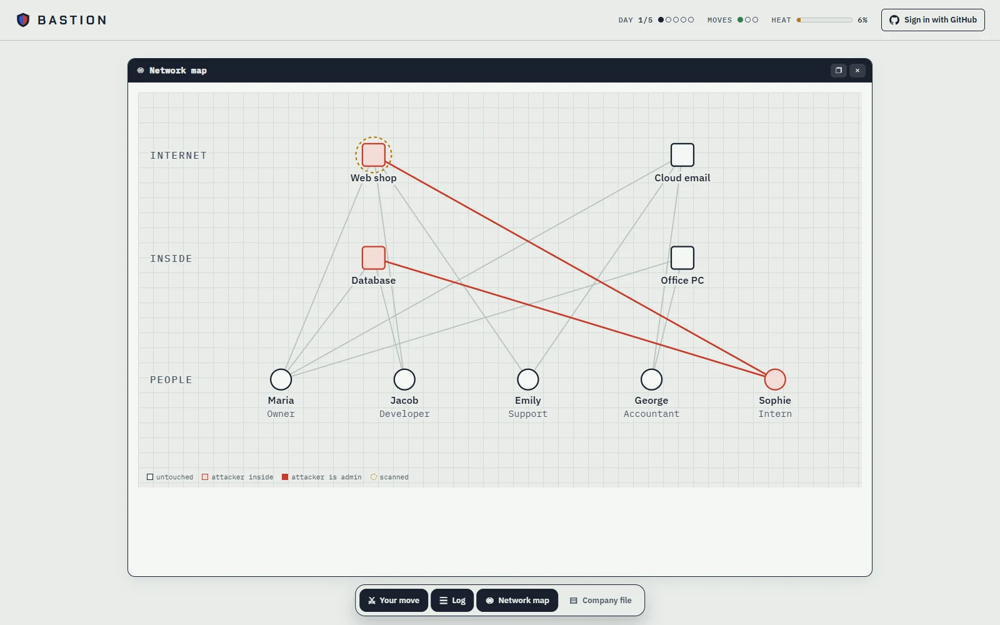

# Bastion

[](https://github.com/DasekCommits/bastion/actions/workflows/ci.yml)

**Build a defense. Switch sides. Break it.**

**Play it in your browser: [bastion.dasek.dev](https://bastion.dasek.dev)**



Bastion is a purple-team training game. Defend a fictional company against a computer attacker, or break into a company the computer defends. Every attack and defense is a real technique mapped to [MITRE ATT&CK](https://attack.mitre.org/), and every game ends with a post-mortem: what was blocked, what got through, what was detected, and which gaps were left open.

It runs in the terminal and in the browser, with the same Python engine in both.

## A game in short

1. **Pick a difficulty, a side and a company.**
2. **Blue** picks defenses within a budget: MFA, patching, a WAF, network segmentation, EDR, a SIEM, backups and more. Each one stops or detects specific attacks.
3. **Red** buys an arsenal once and uses it over a campaign of several days, a few moves a day: recon, initial access, credential theft, privilege escalation, lateral movement, then stealing or destroying data.
4. **Blue plays turns too, like a SOC analyst.** Each time the attacker moves, the analyst gets a move: read the logs, investigate an alert, change a password, isolate a machine, hunt for a hidden attacker or block a sender. Detection tools only write logs, so a SIEM nobody reads catches nobody. False alarms are mixed in, and isolating a clean machine or resetting a clean account costs downtime.
5. **Post-mortem and score** at the end, with advice for both sides on Easy.

| Side | What you do |
|---|---|
| **Blue** | Pick the defenses, then work the alerts as the analyst while the computer attacks. |
| **Red** | Break in. The computer picked defenses you cannot see and plays the analyst against you. |
| **Random** | A coin decides Blue or Red. Double points if you win. |
| **Practice** | Terminal only: play both sides. No points and no unlocks. |

## Companies

| Company | Tier | People | Servers | Blue / Red budget | Days |
|---|---|---|---|---|---|
| Olive Byte, an online olive oil shop | small | 5 | 4 | 40-60 / 40-60 | 5 |
| Harbor Clinic, a private medical clinic | medium | 10 | 7 | 70-90 / 60-80 | 7 |
| Meridian Savings Bank, a regional bank on Active Directory | large | 20 | 12 | 130-170 / 100-140 | 10 |
| Directorate-7, a government directorate (classified) | huge | 100 | 12 | 160-200 / 130-170 | 14 |

Budgets are rolled every game in steps of 5.

**Unlocks.** You start on Olive Byte, Easy. Wins open the rest, one step at a time:

| Win | To unlock |
|---|---|
| 5 on Olive Byte Easy | Harbor Clinic Easy |
| 10 on Harbor Clinic Easy | Medium difficulty (Olive Byte Medium) |
| 5 on Olive Byte Medium | Harbor Clinic Medium |
| 10 on Harbor Clinic Medium | Hard difficulty (Olive Byte Hard) |
| 5 on Olive Byte Hard | Harbor Clinic Hard |
| 10 on Harbor Clinic Hard | Meridian Savings Bank, every difficulty |

Practice games do not count.

- **Small** (9 attacks, 12 defenses): port scan, phishing, password brute force and credential stuffing, a web exploit, privilege escalation, Remote Desktop, data theft and ransomware.
- **Medium** adds a VPN gateway exploit, Office macros, infected USB sticks, bribed insiders and data wiping, answered by macro blocking, USB device control and data loss prevention.
- **Large** adds Active Directory attacks (Kerberoasting, Pass-the-Hash, DCSync), password spraying, MFA fatigue, cloud account takeover, a breached IT vendor and business email compromise, answered by phishing-resistant MFA, LAPS and Credential Guard, a tiered admin model, honeytokens, conditional access, vendor access control, payment call-back checks and a 24/7 SOC.

In total: 22 attacks and 25 defenses. Every company is a JSON file, so new scenarios need no engine changes.

## Difficulty

| | During the game | At the end |
|---|---|---|
| **Easy** | Explanations, success and detection chances, heat | Post-mortem, gaps and advice for both sides |
| **Medium** | Explanations, no numbers | Post-mortem without advice |
| **Hard** | Nothing | Only the result |

Difficulty also changes the odds, so Easy is easier whichever side you play. Each company, difficulty and side has an attacker edge in `src/bastion/data/balance.json`, tuned with thousands of games between computer players so that you win about this often:

| | Small | Medium | Large |
|---|---|---|---|
| Easy | 80% | 70% | 60% |
| Medium | 70% | 50% | 30% |
| Hard | 50% | 30% | 10% |

No single move ever has less than a 5% or more than a 95% chance to succeed or to be spotted, so even a perfect setup on either side can still lose.

A fourth difficulty, **Realism**, and a fourth company, **Directorate-7**, are classified: you unlock them by discovering them in play. In Realism you work a real SIEM with a Splunk-like search over realistic logs (Windows Event IDs, Sysmon, firewall, web, mail) as Blue, or a terminal that leaves those same traces as Red.

## Realism

- **People differ.** Each employee has their own awareness of phishing, password habits and loyalty, so the best target depends on the attack.
- **Mistakes are random.** At most one non-IT employee may have admin rights by mistake, rolled every game. Only Easy shows who.
- **Recon shows only the outside.** A port scan reveals defenses visible from the internet (firewall, WAF, patch level, email filtering, MFA on login pages). A SIEM or segmentation stays hidden, and EDR is only noticed once you are inside. Scanning a login page makes password attacks more effective.
- **Alerts need people.** Every alert has a source (email filter, SIEM, EDR or plain server logs), and real attacks look just like false alarms until someone investigates. At night nobody reads the logs unless the company pays for a 24/7 SOC.
- **Containment has a price.** Changing a password removes access gained through that account only; an attacker who got in another way stays. An isolated machine is offline until the end of the next day.
- **Pivots.** Config files on a web server or VPN can hold passwords that open internal systems, unless the network is segmented.
- **The attacker never learns which hidden defense stopped them.** The post-mortem tells you afterwards.

## Scoring

- **Red wins** by stealing or destroying anything at all. Otherwise **Blue wins**.
- **Blue:** the share of data that survived (0-100), plus 10 for kicking the attacker out, 2 per real attack you confirmed (up to 10) and up to 10 for unspent budget, minus 3 for every needless password reset or isolation.
- **Red:** the share of data stolen or destroyed (0-100), plus up to 10 for finishing early and 10 for owning the whole domain. Never getting caught multiplies the score by 1.5. Each piece of data counts once, even if it is stolen and then encrypted.
- **Random side:** a win counts double.

## Tutorial

A coached lesson for each of the 22 techniques, in kill-chain order: first spot the attack among decoys, then pick the control that best stops it, with the real MITRE ID and block rate explained. Each lesson shows what a technique needs first and what it opens up, and a Combinations section asks you to order techniques into an attack that actually gets through, checked with the engine's own prerequisite rules.

## Fair play

Sign in with GitHub and your progress follows you. Signed-in games are also the only ones that count for the leaderboard and achievements, because their dice are rolled on the server:

1. **Server dice.** Before each move the page tells the server what it is about to play, and only then gets that move's roll: an HMAC of a secret the server keeps for that game and the move's number. The page cannot know a roll in advance, and a move that was already played cannot be played again with a different outcome.
2. **A move log.** The server records every move in order, so the game exists on the server, not just in the browser.
3. **A referee.** A GitHub Actions job runs every 15 minutes, replays each finished game with the same moves and dice through the real engine, and rejects any score the engine does not reproduce. A quit game counts as a loss.

## Achievements

Ten, and all of them hard: for example **Ghost** (win as Red on the bank, on Hard, without a single move spotted) or **Iron Streak** (seven Hard wins in a row). Five are classified and stay redacted until you unlock the content they belong to. Only the referee awards them, from games it has replayed itself.

## WAF Lab

A practice mode in the terminal. A short tutorial explains SQL injection and XSS with a login example, then you build a Web Application Firewall from plain-language rules and watch live how many of 40 real attack payloads it stops and how many of 25 innocent customers it blocks by mistake. It does not change your points: in the game every player's WAF is the same.

Experts can write their own regex rules in `~/.bastion/waf-rules.json` and test them with `python -m bastion waf`. Rules that hang on crafted input (ReDoS) are stopped after five seconds.

## Run it locally

```bash
python -m venv .venv
.venv/Scripts/activate        # on Linux or macOS: source .venv/bin/activate
pip install -e . pytest

python -m bastion play        # the interactive game, with arrow keys
pytest
```

Other commands:

```bash
python -m bastion play --scenario harbor-clinic --difficulty medium --side red --fast
python -m bastion waf                     # test your own WAF rules
python -m bastion check-balance           # play thousands of computer games, fail if a win rate drifts from its target
python -m bastion balance --all           # list choices in the game log that win or lose far too often
python -m bastion --defenses "mfa,patching,email-filter" --attack "phishing:sophie | | exfiltration:db-01"
```

The last one replays a fixed attack plan 1,000 times and prints a day-by-day post-mortem. Commas separate moves and `|` separates days.

## How it is built

- **Engine** (`src/bastion/engine.py`): a turn-based campaign with heat, nights, footholds and detection. Companies, attacks and defenses are data files in `src/bastion/data` and `src/bastion/scenarios`.
- **Computer players** (`ai.py`): the computer attacker only uses what a human would see at that difficulty.
- **Balance** (`tuning.py`): searches the attacker edge for every company, difficulty and side by playing computer games, and CI fails if a win rate drifts from its target.
- **Terminal UI**: `rich`, `questionary` and `prompt_toolkit`.
- **Web version**: the same engine runs in the page with [Pyodide](https://pyodide.org) (Python compiled to WebAssembly). `src/bastion/web.py` is the bridge, `web/` is the page with a live network map, and `tools/build_web.py` packages it.
- **Accounts and fair play**: a small PHP API with MySQL (`web/api`): GitHub sign-in, server dice (`roll.php`), scores and the referee endpoint. The referee itself is `tools/verify_scores.py`, using `src/bastion/dice.py` to replay games and `achievements.py` to award achievements.
- **Tests**: 156 pytest tests, run on every push with GitHub Actions together with the balance check.

## Safety

Bastion never attacks real systems. The network is simulated, and the WAF Lab payloads are plain text matched against your rules, never sent to a live server.

## Roadmap

- [x] Simulation engine, post-mortem and MITRE ATT&CK mapping
- [x] Four companies, four difficulties, Blue, Red and random against the computer
- [x] Blue as an active SOC analyst; Realism with a SIEM and a terminal
- [x] Scoring, tier unlocks and a balance tuned by simulation
- [x] Playable in the browser at [bastion.dasek.dev](https://bastion.dasek.dev)
- [x] Tutorial with lessons and attack chains
- [x] Sign in with GitHub, progress saved to your account, Realism leaderboard
- [x] Server-side dice and a referee that replays every game
- [x] Ten achievements, awarded by the referee
- [x] CI with tests and an automatic balance check
- [x] Achievements shown on [dasek.dev](https://dasek.dev)
- [x] A smarter computer attacker on Hard
- [ ] WAF Lab in the browser

Guests can play without an account; their progress stays in the browser (or `~/.bastion` in the terminal).

## License

[MIT](LICENSE)
